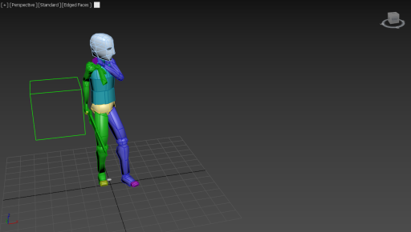

# 3ds Max 애니메이션 · 시험 제출 장면

애니메이션 과목의 시험 제출 파일에 저장된 프레임이다. 상체 앞에서 팔을 접고 두 다리의 위치를 달리한 자세를 확인할 수 있다.

| 장면에서 확인한 항목 | 원본 정보 |
| --- | --- |
| 바이페드 구성 | 골반, 척추, 머리, 좌우 팔다리·손가락, Footsteps 노드 |
| 장면 통계 | 오브젝트 46개, 헬퍼 14개. 정점 1,652개, 면 3,038개 |

이미지는 한 자세를 기록한 장면이다. 바이페드는 3ds Max에서 제공하는 기능이고, 제출 파일에는 캐릭터 모델의 제작자나 제공 샘플 사용 범위가 명시되어 있지 않다. 동작별 키프레임과 재생 시간도 이 이미지에서는 확인되지 않는다.
