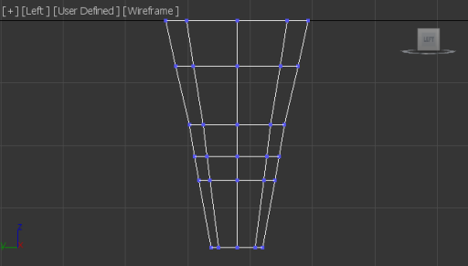

# 3ds Max 모델링 · 제출 장면

모델링 과목에 본인 이름으로 저장한 두 MAX 파일의 장면 통계를 확인했다. 아래 이미지는 두 번째 파일에 원래 저장되어 있던 미리보기다. 왼쪽 뷰에서 아래쪽으로 폭이 줄어드는 단면과 여러 높이에서 나눈 엣지를 확인할 수 있다.

| 제출 장면 | 메시 정점 | 면 | 장면에 기록된 오브젝트 |
| --- | ---: | ---: | --- |
| 장면 1 | 3,101 | 3,084 | Plane001, Plane002, Cylinder001 |
| 장면 2 · 위 이미지 | 338 | 327 | Cylinder001, Cylinder002 |

통계는 파일에 기록된 전체 장면 기준이다. 같은 과목 폴더에는 수업 예시와 참조 이미지도 함께 보관돼 있다. 두 제출 파일에는 오브젝트별 제작자나 제공 모델의 사용 범위가 명시되어 있지 않다.
