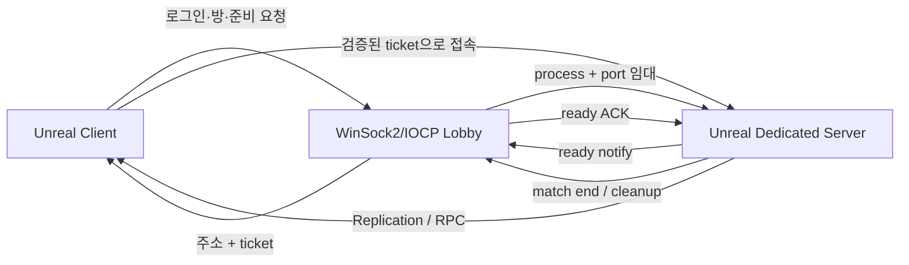

# Dophamine Addiction

TPS 전투와 섯다 카드게임을 순환하는 Unreal Engine Dedicated Server 멀티플레이 졸업작품입니다.

- 기간: 2026.01–2026.08
- 인원: 4명
- 역할 배정: 서버 전 영역 및 물리
- 직접 확인되는 주력 기여: WinSock2/IOCP 로그인·로비 서버, Lobby↔Dedicated Server lifecycle, ticket·reconnect·readiness, 서버 권위 상태·판정, 서버 권위 충돌·획득 판정과 카드 배치 일부
- 기술: Unreal Engine 5.7, C++, Dedicated Server, Replication/RPC, WinSock2/IOCP, TCP
- 상태: Release 빌드, 서버·클라이언트를 포함한 4대 PC 실제 플레이 검증
- 영상: [졸업작품 소개 영상](https://youtu.be/Gi9b-EheNaE)

> 코드 프로젝트와 과거 자료에는 `Manager` 또는 `Dopamine Addiction` 표기가 남아 있습니다. 이 포트폴리오에서는 제출용 프로젝트명인 `Dophamine Addiction`을 사용하며, 원본 파일명은 추적 가능성을 위해 바꾸지 않았습니다.

## 전체 구조

클라이언트는 행동을 요청하고, phase·소유권·거리·카드 상태·베팅 가능 여부 같은 게임 판정은 서버에서 수행하도록 구성했습니다.

## 구현 내용

### 1. 로그인·로비 전송 계층

- `select`로 listen socket의 수락 가능 상태를 확인하고 `WSAAccept`로 접속을 받습니다.
- 수락한 client socket을 completion port에 연결하고 `WSARecv`/`WSASend` 완료를 고정 4개 worker가 처리합니다.
- TCP 수신 누적 버퍼에서 packet header의 size를 읽어 붙거나 나뉜 packet을 복원합니다.
- 세션별 send queue와 send-in-flight 상태로 순서를 보존하고 partial send를 이어서 처리합니다.
- 연결 상한, 인증 전 packet 제한, packet size/type/rate 검증으로 비정상 입력의 영향을 제한합니다.

Manager의 로비 서버는 `AcceptEx` 방식이 아닙니다. 별도의 개인 IOCP MMORPG 프로젝트와 구현을 혼동하지 않도록 이 차이를 명시합니다.

### 2. Lobby에서 Dedicated Server로의 인계

- 방 상태 검증 후 사용할 port를 임대합니다.
- Dedicated Server process를 실행하고 Job Object로 수명을 묶습니다.
- Dedi의 ready notify를 검증하고 Lobby가 ready ACK를 반환한 뒤에만 client에 주소와 ticket을 전달합니다.
- 실행 실패 시 port/process/room 상태를 rollback하고, match 종료·유실 session은 회수합니다.

### 3. Dedicated Server 내부 상태 관리

- ticket, user와 slot을 검증한 뒤 접속을 승인합니다.
- client별 level streaming과 card bundle 준비 ACK를 모은 뒤 spawn/phase를 진행합니다.
- reconnect grace period 동안 snapshot과 위치·카드·골드 상태를 보존하고 재접속 시 복원합니다.
- match 종료 시 Lobby에 결과를 통지하고 Dedi와 port를 정리합니다.

### 4. 서버 권위 게임 규칙

- TPS와 카드 phase를 서버 상태로 전환합니다.
- 클라이언트 RPC마다 authority, ownership, phase, rate와 요청 값의 유효성을 검사합니다.
- 비공개 패는 owner에게만, 공개 패와 제출 결과는 전체에게 동기화합니다.
- 기존 공동 카드 시스템에 selection/bet-turn timeout, all-in 상태·턴 진행 보강, 결정적 동점 pot 분배와 reconnect-safe gold ledger를 추가했습니다.
- `AllIn` 액션을 포함한 기반 betting core는 팀 공동 코드이며, 위 항목은 본인이 추가한 안정화 범위입니다.
- `MainGameMode::DropGoldFromPlayer`에서 사망 시 드롭 조건·금액·지면 위치를 서버가 결정하고, actor를 직접 spawn한 뒤 ledger 차감과 초기화를 수행합니다. `GoldDropActor`에서는 replication 초기화와 authority-only overlap 획득을 처리합니다.

## 코드 검토 방법

팀 저장소의 현재 파일에는 여러 팀원의 수정 라인이 함께 존재합니다. 원본 저장소는 비공개이고 Config token·외부 asset도 포함하므로 그대로 Public 전환하지 않았습니다. 대신 고정 commit에서 현재 `git blame`과 개발 기록으로 확인한 함수 구간을 새 저장소에 발췌해 넣었습니다.

1. [`SOURCE_LINKS.md`](SOURCE_LINKS.md) — 로컬 코드 발췌본을 로비 서버 → Dedi lifecycle → readiness/reconnect → 카드 안정화 순서로 안내
2. [`CONTRIBUTIONS.md`](CONTRIBUTIONS.md) — 파일별 기여 범위와 공동 작업 경계
3. [`source/GoldDropActor.h`](source/GoldDropActor.h) — 현재 줄 기준 100% 직접 작성이 확인되는 원본 header
4. [`docs/devlog`](docs/devlog/) — 본인이 작성한 개발 기록

`evidence/excerpts`의 파일은 원본 경로·고정 commit·line range·blame 근거를 상단에 적은 **비독립 실행 발췌본**입니다. 주변 팀 코드는 제외했고, 읽기 흐름을 위해 남긴 타인 attribution의 빈 줄·중괄호는 파일별 header에서 수량을 공개합니다.

## 검증과 한계

- 실제 Release 환경에서 서버와 클라이언트를 분리해 4대 PC 플레이를 확인했습니다.
- 60명은 기획 목표였으며 실측 결과로 주장하지 않습니다.
- 현재 계정 처리는 메모리 기반 평문 비교이며 production 인증이 아닙니다. TLS, password hash, account lockout을 구현했다고 주장하지 않습니다.
- `RopeBridge`, `FloatingMotionComponent`, Chaos memory 최적화는 본인 구현 근거가 확인되지 않아 기여 성과와 공개 코드에서 제외했습니다.
- 공개된 문서는 개인 작업 기록이지만, 기록이 다루는 최종 소스 파일에는 팀원 기여가 함께 있을 수 있습니다.

## 공개 범위

`Content`, 외부 에셋, 빌드 결과, Config token, 팀원 중심 UI·아트 코드와 원본 `.git` 이력은 이 묶음에 포함하지 않습니다. 기존 공동 저장소는 비공개 상태를 유지하며, 채용 검토에는 이 저장소의 선별 코드·기여표·개발 기록·영상만 사용합니다.
