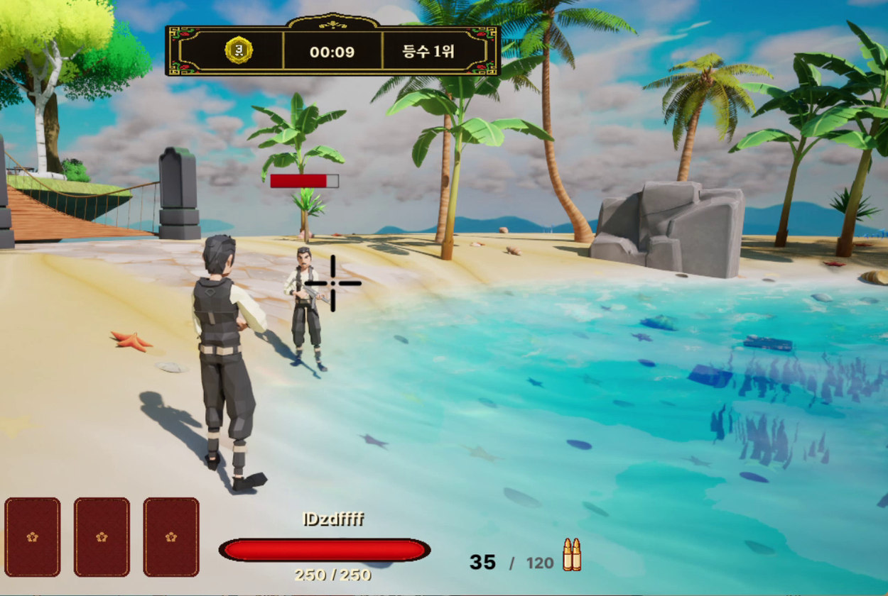
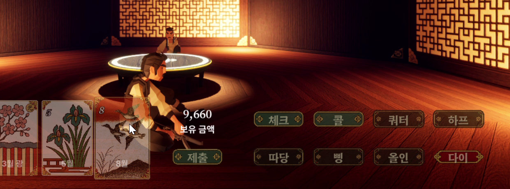

# TPS 전투에서 고른 패로 섯다를 하는 게임

섬에서 교전하며 모은 화투를 다음 섯다판으로 가져가는 멀티플레이 게임입니다. 저는 두 장르를 결합하는 아이디어를 제안하고 라운드 진행과 카드 처리 규칙을 구체화했습니다. 골드를 걸고 세 라운드 뒤 잔액으로 최종 순위를 정하는 방식은 팀에서 함께 정했습니다.

## 같은 골드를 쓰는 세 가지 선택

전투에서 모은 골드로 체력을 강화하면 다음 교전에서 더 오래 버틸 수 있습니다. 소비한 만큼 다음 섯다에서 걸 수 있는 돈과 최종 순위에 반영될 잔액이 줄어듭니다. 죽으면 골드는 떨어지지만 골라 둔 카드는 남습니다. 카드를 세 장까지 모으지 못한 사람에게도 부족한 패를 채워 섯다에 참여할 수 있게 했습니다.

## 공개한 카드를 실제 승부에 쓸 수 있도록

초기에는 보유 카드 세 장 중 하나를 공개하는 순간 나머지 두 장이 최종 패로 결정됐습니다. 공개할 카드 한 장을 먼저 고른 뒤, 최종 패 두 장을 별도로 제출하도록 바꿨습니다. 예를 들어 3월 광을 보여 준 사람이 3월·8월로 승부할 수도, 공개한 카드를 빼고 5월·8월로 승부할 수도 있습니다. 모두 제출한 뒤 베팅이 시작됩니다.

[시연 영상](https://youtu.be/Gi9b-EheNaE) · [선택 판정 수정 일지](../docs/devlog/Manager_섯다_공개카드_최종패_분리_2026-07-21.md) · [팀 내 개인 기여 내역](../CONTRIBUTIONS.md)
