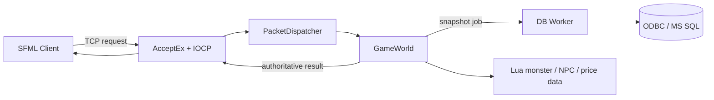
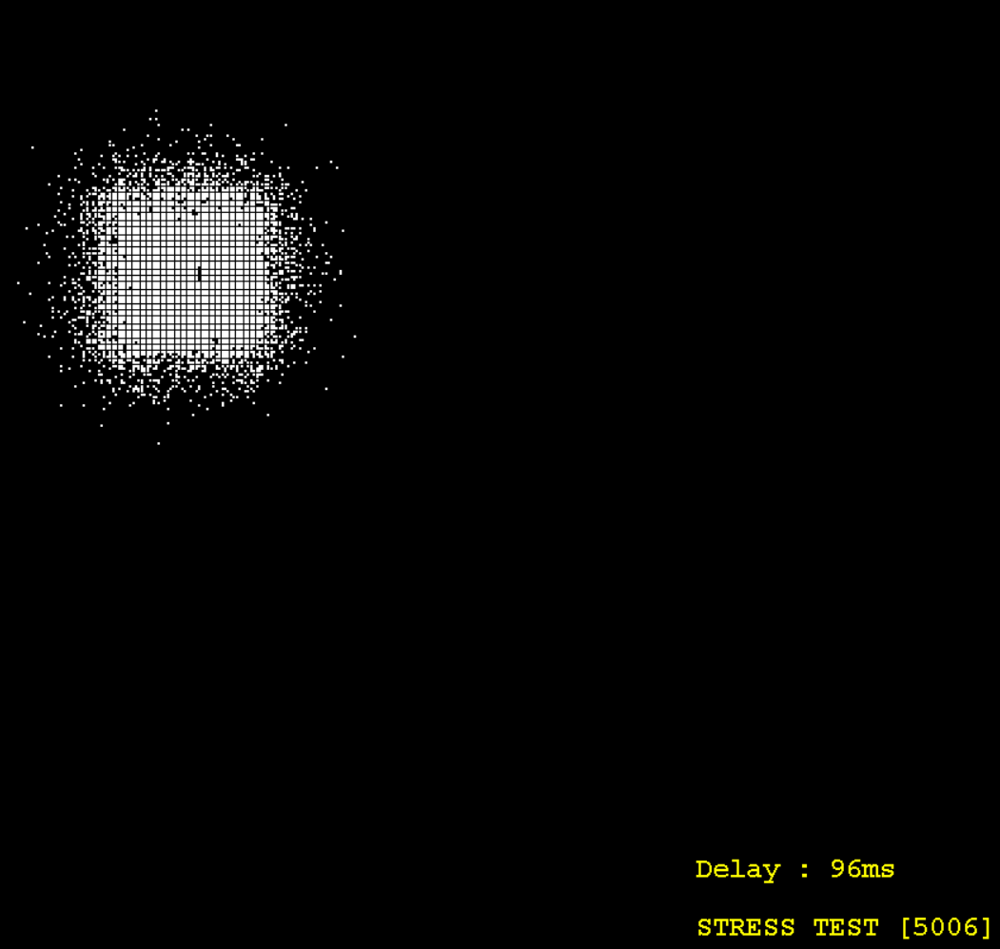

# C++ IOCP 2D MMORPG

WinSock2 IOCP 서버, SFML 클라이언트, ODBC/MS SQL 영속화와 Lua 콘텐츠 데이터를 연결한 2D MMORPG 학기 프로젝트입니다.

- 기간: 2026.05–2026.06
- 유형: 한국공학대학교 게임 서버 텀프로젝트
- 담당 범위: IOCP 서버, session/packet 처리, 서버 권위 게임 로직, ODBC 영속화, Lua 데이터 연동, SFML client 연동과 부하 시험 구성
- 기술: C++17, WinSock2/IOCP, AcceptEx, SFML, ODBC/MS SQL, Lua, Visual Studio
- 상태: 원본 환경에서 구현·실행 시험 완료. 공개본은 수업 제공 protocol header를 제외했기 때문에 즉시 완전 빌드되는 배포본은 아닙니다.

## 구조

IOCP worker는 socket completion, packet 조립·검증·분기와 요청으로 즉시 실행되는 `GameWorld` 로직을 같은 호출 흐름에서 처리합니다. ODBC 작업은 DB 연결에 성공한 경우 별도 DB worker로 보내고, monster AI·buff·respawn 같은 주기적 update는 별도 world thread에서 처리합니다.

## 구현 내용과 설계 이유

### 1. AcceptEx와 IOCP completion

- 시작 시 AcceptEx 요청 64개를 미리 게시합니다.
- accept/recv/send마다 OVERLAPPED context의 작업 종류를 구분해 하나의 completion loop에서 dispatch합니다.
- worker 수는 고정값이 아니라 `std::thread::hardware_concurrency()`로 결정하고, CPU 정보를 얻지 못하면 4개를 사용합니다.
- DB 연결에 성공하면 DB worker 1개가 추가되고, DB 연결 여부와 관계없이 WorldUpdateLoop 1개가 동작합니다. 연결 실패 시에는 memory-only mode로 실행됩니다.

코드: [`IocpServer.cpp`](source/Server/IocpServer.cpp), [`IocpEvent.h`](source/Server/IocpEvent.h), [`ServerConfig.h`](source/Server/ServerConfig.h)

### 2. TCP framing과 session 수명

- recv 결과를 session 누적 buffer에 넣고 첫 byte의 packet size를 기준으로 complete packet만 반복 추출합니다.
- 붙어서 온 packet과 여러 recv로 나뉜 packet을 같은 경로에서 처리합니다.
- session은 연결·로그인·disconnect 상태와 pending send 수를 atomic으로 관리하고, packet buffer와 진행 상태는 mutex로 보호합니다.
- session의 pending send가 이미 512개인 상태에서 추가 송신을 시작하려 하면, 느린 한 client의 적체가 서버 전체로 번지지 않도록 해당 session을 종료합니다.

현재 구현은 **hard limit + disconnect**입니다. 이동 packet만 버리는 soft-drop은 구현되어 있지 않습니다. 또한 partial send 재게시와 session별 send FIFO도 현재 코드에 없으므로 완료 기능으로 주장하지 않습니다.

코드: [`ClientSession.cpp`](source/Server/ClientSession.cpp), [`IocpServer.cpp`](source/Server/IocpServer.cpp)

### 3. 서버 권위 packet 처리

`PacketDispatcher`는 packet type과 size를 확인한 뒤 `GameWorld`의 login, movement, attack, item, equipment, quick slot, skill, NPC 요청으로 전달합니다. client는 요청만 보내고 위치·공격·보상·inventory 변화는 서버 상태를 기준으로 계산합니다.

코드: [`PacketDispatcher.cpp`](source/Server/PacketDispatcher.cpp), [`GameProtocol.h`](source/Server/GameProtocol.h)

### 4. World thread와 관심 영역

- WorldUpdateLoop에서 monster AI, buff/respawn, HP regeneration, drop expiration을 서로 다른 간격으로 갱신합니다.
- sector와 view list를 사용해 전체 접속자에게 매번 broadcast하지 않고 주변 player/monster만 add/remove/move합니다.
- monster aggro, A* path finding, combat, 개인 drop, inventory, equipment와 skill을 서버에서 처리합니다.

코드 리뷰 시작점: [`GameWorld.cpp`](source/Server/GameWorld.cpp)의 `WorldUpdateLoop`, `UpdateMonsterAi`, `FindPathAStar`, `HandlePlayerAttack`, `CreatePersonalDropsForMonster`, `UseSkill`

### 5. DB worker와 값 snapshot

SQL 호출이 IOCP worker를 오래 막지 않도록 login/save job queue를 별도 DB worker가 처리합니다. 저장 작업은 session object를 오래 참조하지 않고 필요한 값을 snapshot으로 복사한 뒤 queue에 넣어 disconnect와 DB 완료의 수명 경합을 줄였습니다.

- `condition_variable`로 job을 대기
- login/load 결과를 world completion queue로 반환
- ODBC를 통해 player, skill, equipment, inventory와 quick slot을 저장·복구

코드: [`DatabaseManager.cpp`](source/Server/DatabaseManager.cpp), [`GameWorld.cpp`](source/Server/GameWorld.cpp)

### 6. Lua 콘텐츠 분리

monster, NPC와 item 판매 가격을 Lua script에서 읽어 C++ 재컴파일 없이 콘텐츠 값을 바꿀 수 있도록 분리했습니다.

코드: [`source/Server/Scripts`](https://github.com/2021180033-LTH/game-programming-portfolio/tree/main/projects/02-iocp-2d-mmorpg/source/Server/Scripts)

## 5분 코드 리뷰 순서

1. [`IocpServer.cpp`](source/Server/IocpServer.cpp) — `Start` → `PostAccept` → `WorkerThreadLoop` → `HandleAccept/Recv/Send`
2. [`ClientSession.cpp`](source/Server/ClientSession.cpp) — session state, recv buffer, pending send count
3. [`PacketDispatcher.cpp`](source/Server/PacketDispatcher.cpp) — packet validation과 command dispatch
4. [`GameWorld.cpp`](source/Server/GameWorld.cpp) — DB job, world loop, sector/A*, combat·inventory·skill
5. [`DatabaseManager.cpp`](source/Server/DatabaseManager.cpp) — ODBC 연결과 CRUD
6. [`source/Client/main.cpp`](source/Client/main.cpp) — SFML client UI, 입력, packet 반영

자세한 mapping은 [`docs/IMPLEMENTATION_MAP.md`](docs/IMPLEMENTATION_MAP.md)를 참고하세요.

## 실행 증빙과 부하 시험

- 실행 화면에서 `STRESS TEST [5006]`와 `Delay : 96ms` 표시를 확인할 수 있습니다.
- 당시 작성 기록에는 별도 PC와 server PC를 유선 LAN으로 연결해 5,000명대, 60–110ms, 10분 이상 유지했다고 적혀 있습니다.
- 원시 RTT log, CPU/memory 기록과 동일 조건 재현 script는 남아 있지 않습니다. 따라서 이는 **발표 당시 자체 측정 기록**이며 5,000명 안정 처리 보장이나 독립 검증 결과로 표현하지 않습니다.

추가 화면은 [`docs/images`](https://github.com/2021180033-LTH/game-programming-portfolio/tree/main/projects/02-iocp-2d-mmorpg/docs/images)에 있습니다.

## 빌드 조건

원본 개발 환경은 Windows, Visual Studio, WinSock2, ODBC/MS SQL, SFML 2.5.1과 Lua였습니다.

공개본에서 의도적으로 제외한 항목이 있습니다.

- `protocol_2026.h`: 수업에서 제공된 원본 header로 확인되어 공개 허가 전 제외
- SFML NuGet package 본체: third-party package를 복제하지 않고 `packages.config`만 포함
- Lua header/library 본체와 로컬 연결 설정: source에는 Lua API 사용부와 script만 남기고 third-party binary는 포함하지 않음
- client `Assets` 폴더: 이미지·font 등 각 asset의 공개 권리를 다시 확인하기 전 제외
- DB backup과 schema 원본: 실제 account/data와 환경 정보를 포함할 수 있어 제외
- StressTest harness 전체: `DrawModule.cpp`에 NeHe 기반 타인 코드와 개인 LAN IP가 있었고, 나머지 harness도 그 파일에 의존하므로 공개본에서는 전체 제외

따라서 이 저장소의 `source`는 코드 리뷰용 원본 묶음입니다. 로컬에서 완전 빌드하려면 적법하게 확보한 protocol header, SFML, Lua 개발 header/library와 client asset을 준비하고 project의 Lua include/link 설정을 로컬 환경에 맞게 추가해야 합니다.

## 알려진 한계

- partial send continuation과 per-session send FIFO가 없습니다.
- pending send가 512개인 상태에서 추가 송신 시 선택적 packet drop이 아니라 session을 종료합니다.
- DB 연결 문자열을 환경변수로 덮어쓸 수 있지만, 현재 연결 성공 log가 전체 문자열을 출력하므로 비밀번호가 포함된 값을 넣으면 log에 노출될 수 있습니다.
- 공개 묶음만으로 MS SQL schema와 원래 account data를 재현할 수 없습니다.
- StressTest harness와 부하 시험 raw log가 없어 당시 측정값을 다시 계산하거나 같은 조건으로 재현할 수 없습니다.
- 공개본에는 client asset이 없어 캡처와 같은 시각 결과를 그대로 재현할 수 없습니다.

공개 포장 변경은 [`docs/PACKAGING_CHANGES.md`](docs/PACKAGING_CHANGES.md)에 기록했습니다.
