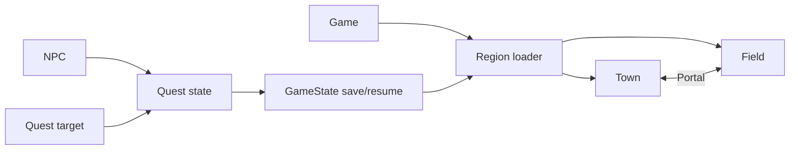
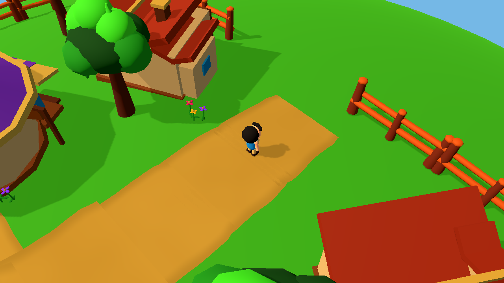
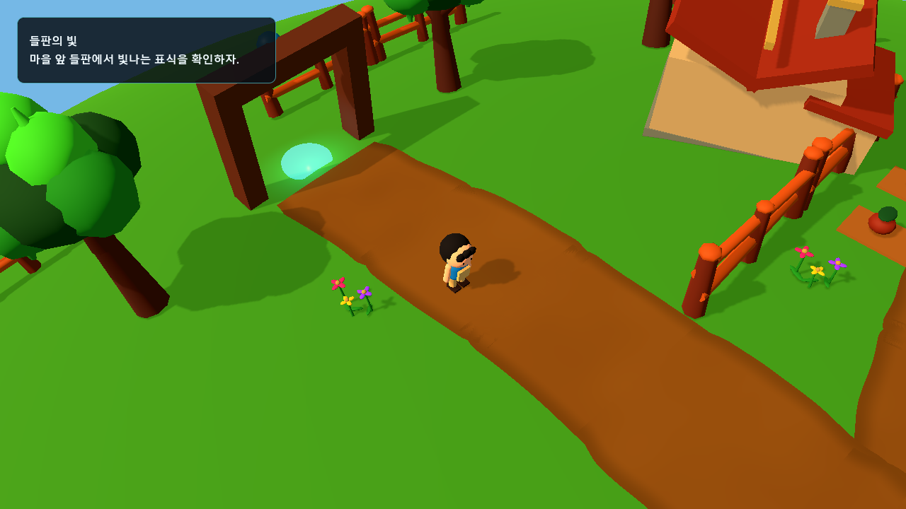

# EverPlanet World Study

어릴 때 즐겨 했던 Nexon 게임 `EverPlanet`을 개발 연습의 출발점으로 삼아, “작은 행성 위의 이동·카메라·지역 전환을 기술적으로 어떻게 구현했을까?”를 질문하며 AI와 함께 분석하고 구현하는 비공식 개인 연구 프로젝트입니다.

원작의 source, model, texture, UI, audio를 복사하지 않았습니다. 이 저장소의 code와 graybox/visual kit는 기술 연구를 위해 별도로 작성한 것입니다.

## 개발 단계

| 단계 | 위치 | 내용 | 상태 |
|---|---|---|---|
| 초기 Canvas prototype | [`archive/early-canvas-prototype.html`](archive/early-canvas-prototype.html) | browser에서 실행하는 초기 공간·상호작용 실험 | archive |
| Unreal 기술 연구 | [`unreal-study`](https://github.com/2021180033-LTH/game-programming-portfolio/tree/main/projects/03-everplanet-world-study/unreal-study) | 구면 중력, 접선 이동, local-Up camera, world progression, 자동화 test/tool | 이전 연구 기준 |
| Godot 8월 시제품 | [시제품 코드와 장면](godot-current) | 마을·필드 왕복, 의뢰 한 개의 4단계 진행, 저장과 재개 | 공개 코드 |
| Godot 10월 개발본 | [게임 규칙과 플레이 검증 기록](october-gameplay.md) | 다섯 지역, 의뢰 열 개, 전투·거래·장비, 저장 후 재개 | 규칙과 시험 사례 발췌 |

- Unreal 연구 시작: 2026.08
- Godot 전환 및 첫 playable slice: 2026.08.27–
- 인원: 1명, AI 보조
- 현재 기술: Godot 4.7.2 .NET build, GDScript-first
- 이전 연구 기술: Unreal Engine 5 C++, Unreal Python, Automation Test

## 왜 Unreal 연구와 Godot 구현을 함께 남겼나

Unreal 단계에서는 구면 공간의 수학과 engine lifecycle을 깊게 검증했습니다. 이후 빠르게 작은 playable slice를 만들고 지역·quest·save·시각 개선을 반복하기 위해 신규 구현 방향을 Godot으로 전환했습니다.

이전 작업을 완성 게임처럼 포장하지 않고, 어떤 기술 문제를 해결했고 다음 구현에 무엇을 가져왔는지 확인할 수 있도록 연구 archive로 남겼습니다.

## 10월에 추가한 플레이

8월 시제품에서는 마을에서 의뢰를 받고 필드에서 목표를 조사한 뒤 NPC에게 돌아오는 흐름을 만들었습니다. 10월 개발본에서는 몬스터를 잡아 얻은 물품을 의뢰에 쓰거나 상점에서 거래할 수 있습니다. 의뢰를 마친 뒤 게임을 종료하고 다시 열어 소지품과 장착한 장비가 복원되는 과정까지 확인했습니다. [전투·거래·저장 시험](october-gameplay.md)

## 8월 Godot 시제품

### 구현된 first slice

- Town과 Field의 영구 scene, 양방향 portal과 spawn 검증
- `not_started → active → ready_to_turn_in → completed` quest 상태
- NPC dialogue와 Field quest target interaction
- 현재 region/spawn, unlocked region과 quest 상태 저장·재개
- 잘못된 save version/location을 기본 Town spawn으로 되돌리는 방어 경로
- 고정 camera rig와 input lock, transition 중 중복 요청 방지
- reusable environment kit, material palette와 organic path shader

8월 Godot 시제품에서 중력은 월드 좌표의 `-Y` 방향으로 작용합니다. 구면 중력과 접선 이동을 시험한 코드는 아래 Unreal 연구에 있습니다.

### 코드 리뷰 순서

1. [`autoload/game_state.gd`](godot-current/autoload/game_state.gd) — save schema, quest와 region 상태
2. [`game/game.gd`](godot-current/game/game.gd) — region load와 transition guard
3. [`gameplay/player/player.gd`](godot-current/gameplay/player/player.gd) — 이동·상호작용
4. [`gameplay/interactables`](https://github.com/2021180033-LTH/game-programming-portfolio/tree/main/projects/03-everplanet-world-study/godot-current/gameplay/interactables) — NPC, portal, quest target
5. [`gameplay/camera/fixed_camera_rig.gd`](godot-current/gameplay/camera/fixed_camera_rig.gd) — camera framing
6. [`data/first_slice.json`](godot-current/data/first_slice.json) — region·quest data contract

### 실행

Godot 4.7.2 .NET build에서 [`godot-current/project.godot`](godot-current/project.godot)을 열고 project를 실행합니다. 구현은 GDScript-first이며 현재 C# assembly를 요구하는 gameplay code는 없습니다.

### 진행 캡처

| Town visual pass 02 | Field visual pass 02 |
|---|---|
|  |  |

이는 완성 artwork가 아니라 동선, silhouette, palette와 기능 object를 함께 검증하는 초기 environment pass입니다.

## Unreal C++ 기술 연구

### 1. 행성 중력과 접선 이동

- actor 위치와 행성 중심으로 surface normal/local up 계산
- 중력을 행성 중심 방향으로 적용
- 입력 vector를 surface tangent plane에 투영
- camera forward가 normal과 평행해지는 특이점에서 안정적인 tangent basis fallback
- Movement → Camera → SpringArm tick prerequisite 명시

코드: [`PlanetGravityMath.cpp`](unreal-study/Source/EverPlanet/Planet/PlanetGravityMath.cpp), [`PlanetGravityComponent.cpp`](unreal-study/Source/EverPlanet/Planet/PlanetGravityComponent.cpp), [`EverPlanetSphericalCharacter.cpp`](unreal-study/Source/EverPlanet/Planet/EverPlanetSphericalCharacter.cpp)

### 2. local-Up camera frame

- 이전 tangent를 새 surface plane으로 parallel transport
- local-Up을 기준으로 yaw quaternion 구성
- exponential smoothing과 Slerp로 회전 보간
- pole 부근에서도 roll이 임의로 뒤집히지 않도록 frame을 연속적으로 유지

코드: [`GlobeCameraMath.cpp`](unreal-study/Source/EverPlanet/Camera/GlobeCameraMath.cpp), [`PlanetGlobeCameraComponent.cpp`](unreal-study/Source/EverPlanet/Camera/PlanetGlobeCameraComponent.cpp)

### 3. 검증과 콘텐츠 tool

- 순수 수학 automation test
- PIE runtime에서 여러 방향 착지·이동·camera frame 검증
- world catalog, region portal과 save/progression test
- Unreal Python으로 test content와 first planet graybox 생성·patch
- Blueprint compile allow-list로 예상 대상만 검사

코드: [`unreal-study/Source/EverPlanet/Tests`](https://github.com/2021180033-LTH/game-programming-portfolio/tree/main/projects/03-everplanet-world-study/unreal-study/Source/EverPlanet/Tests), [`unreal-study/Source/EverPlanetEditorTests`](https://github.com/2021180033-LTH/game-programming-portfolio/tree/main/projects/03-everplanet-world-study/unreal-study/Source/EverPlanetEditorTests), [`unreal-study/Scripts/Unreal`](https://github.com/2021180033-LTH/game-programming-portfolio/tree/main/projects/03-everplanet-world-study/unreal-study/Scripts/Unreal)

Unreal `Content`, generated cache와 local-only credential을 포함한 `DefaultEngine.ini`는 공개본에서 제외했으므로 이 폴더 단독으로 완전한 Unreal project를 실행할 수는 없습니다. 목적은 본인이 설계·적용·검증하고 설명할 수 있는 C++ 수학·gameplay·test/tool code review입니다.

공개한 Unreal C++/Build 파일의 첫 줄 `Copyright Epic Games, Inc.`는 Unreal project template이 자동으로 넣은 boilerplate header를 원본 그대로 보존한 것입니다. 해당 문구를 아래 구현 전체가 Epic 제공 code라는 의미로 사용하지 않으며, 프로젝트별 구현 범위는 이 README의 기능·파일 mapping으로 설명합니다.

공개 포장 과정에서 개인 drive를 고정한 PowerShell wrapper는 제외했고, 한 Python patch script의 project root는 `EVERPLANET_PROJECT_ROOT` environment variable 또는 상대 경로를 사용하도록 바꿨습니다. 원본/공개본 hash 차이는 저장소 공통 source manifest에 기록했습니다.

## AI 활용

AI를 설계 대안 조사, code 초안, test case 도출, document 정리에 활용했습니다. 이태현은 구현 방향·요구사항을 정하고, 실제 project 적용, local 실행, 실패 분석과 최종 수용 여부를 판단했습니다. 자세한 범위는 [`AI_ASSISTANCE.md`](AI_ASSISTANCE.md)에 있습니다.

## 현재 한계

- Godot first slice는 기능과 초기 시각 언어를 검증한 단계이며 완성 game/art가 아닙니다.
- 원작의 정확한 quest 문구·수치·asset을 재현하지 않습니다.
- Godot의 radial gravity와 다중 planet traversal은 아직 후속 목표입니다.
- Unreal 연구의 다중 planet 전환과 전체 manual coverage는 완료 claim에서 제외합니다.

권리와 제외 범위는 [`IP_NOTICE.md`](IP_NOTICE.md)를 확인해 주세요.
