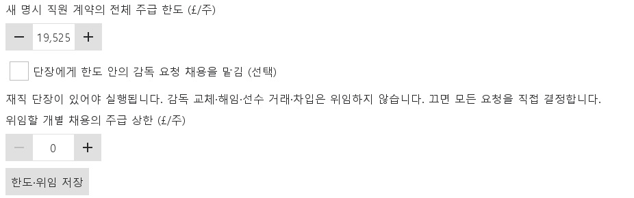
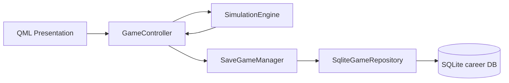

# Football Owner

**Football Manager를 기반으로**, 감독이 아니라 구단주 관점에서 축구 구단 운영과 역사 분기를 재해석한 비공식 개인 시뮬레이션 프로젝트입니다.

- 기간: 2026.07–현재
- 인원: 1명
- 역할: 게임 방향·기획, 요구사항과 우선순위, 도메인 규칙, 결과 검토·검증, 구현 통합
- 기술: C++20, Qt 6/QML, SQLite, CMake, CTest
- 현재 개발본: 0.24.0. 이 폴더 루트의 빌드 가능한 공개 코드는 MVP 0.10.0이며, 최신 운영 규칙·테스트는 [0.24 발췌본](design-history/rules-v0.24/README.md)에 있습니다.
- 상태: 운영·이적·임대·재계약·AI 시장·저장 구조를 구현한 개발 중 프로젝트

Sports Interactive 또는 Football Manager와 제휴·승인 관계가 없습니다. 공개본에는 실존 선수·구단의 대규모 원천 데이터와 이미지를 넣지 않았습니다. 다만 코드 리뷰와 규칙 검증을 위해 1992-93 Manchester United를 기준으로 한 **소규모 내장 prototype fixture**는 남겼습니다. 이름·생년월일·당시 소속은 공식/공개 역사 자료로 교차 확인했고, 능력·금액·계약·스카우팅 수치는 자체 `prototype_estimate`/`gameplay_estimate`이며 Football Manager DB나 rating을 복제한 값이 아닙니다.

사용한 출처와 사실/추정치 구분은 [`docs/HISTORICAL_DATA_PROVENANCE.md`](docs/HISTORICAL_DATA_PROVENANCE.md)에 기록했습니다.

## 기획서 1차부터 8차까지

FM에서 좋아하는 선수를 모아 키우는 일은 즐거웠지만, 성적이 나빠져 팀에서 경질될까 봐 다른 유저의 전술을 내려받아 쓰기도 했습니다. 시설 투자도 좋은 성적과 충분한 자금이 있어도 거절된 적이 많았습니다. 그래서 선수단과 투자 방향은 제가 정하고 경기 지휘는 감독에게 맡기는 게임을 구상했습니다. 1992년 여름에 구단을 인수하고, 기억에 남는 선수들로 명문을 재건하거나 기존 강팀의 기록을 다시 쓰는 것이 목표입니다.

[1~8차 기획서 전문과 개정 이력](design-history/README.md) · [통합 기획서 8차](design-history/versions/v08-career-and-era-rules.pdf) · [0.24 운영 규칙과 테스트](design-history/rules-v0.24/README.md)



[스카우트 보고서](design-history/screens/owner_scout_report.jpg) · [재계약 협상](design-history/screens/football_renewal.jpg) · [구단 결산](design-history/screens/football_settlement.jpg)

## 설계 목표

Football Manager의 감독 중심 플레이를 그대로 복제하지 않고, 다음 질문을 중심으로 설계했습니다.

- 구단주가 영입·매각·계약·예산을 어디까지 직접 승인할 것인가?
- 감독·스카우트·재무 담당자의 의견과 구단주 결정이 어떻게 충돌하고 기록되는가?
- 협상 중 약정과 실제 현금 흐름을 어떻게 분리해 중복 지출을 막을 것인가?
- 날짜가 진행될 때 AI 구단과 계약·임대·지급 일정이 정확히 한 번만 반영되게 하려면 어떤 상태가 필요한가?
- 기존 save를 깨지 않고 규칙과 schema를 단계적으로 확장하려면 어떻게 해야 하는가?

공개용 기획 요약은 [`docs/DESIGN_SUMMARY.md`](docs/DESIGN_SUMMARY.md)에 있습니다.

## 구조



| 계층 | 위치 | 책임 |
|---|---|---|
| Core | [`src/core`](https://github.com/2021180033-LTH/game-programming-portfolio/tree/main/projects/04-football-owner/src/core) | 날짜, 상태, event queue, 이적·임대·계약·AI 시장 규칙 |
| Application | [`src/application`](https://github.com/2021180033-LTH/game-programming-portfolio/tree/main/projects/04-football-owner/src/application) | QML용 상태 변환, command, 저장·rollback orchestration |
| Infrastructure | [`src/infrastructure`](https://github.com/2021180033-LTH/game-programming-portfolio/tree/main/projects/04-football-owner/src/infrastructure) | SQLite migration/repository, save file 수명과 안전 교체 |
| Presentation | [`qml`](https://github.com/2021180033-LTH/game-programming-portfolio/tree/main/projects/04-football-owner/qml) | 시작, dashboard, squad, transfer, scouting, finance UI |

Core에는 Qt header를 넣지 않아 `core-only-debug` preset으로 UI와 대규모 역사 데이터 없이 규칙 회귀 테스트를 실행할 수 있습니다.

## 구현 내용과 이유

### 1. 날짜 기반 simulation state machine

`SimulationEngine`은 하루 단위로 상태를 진행하며, transfer pursuit, outgoing offer, scouting, loan, contract renewal, payment, fixture와 AI market의 만기 상태를 처리합니다.

- 제안·역제안·합의·최종 승인·완료를 분리
- 완료일 전에는 선수 소속과 실제 현금을 바꾸지 않음
- 완료 여부를 저장해 save/load 뒤 날짜를 다시 진행해도 중복 반영하지 않음
- 1992–93 등록 마감과 보스만 판결 이전 계약 규칙을 별도 rule로 처리

코드: [`simulation_engine.cpp`](src/core/simulation_engine.cpp), [`game_state.h`](src/core/game_state.h)

### 2. 현금, 예산과 미래 약정 분리

즉시 지급액과 할부·bonus·future fee를 일정으로 나누고, 진행 중인 최대 약정을 available cash에서 예약합니다. 한 협상이 진행되는 동안 같은 자금을 다른 영입에 중복 사용하지 않도록 하기 위한 선택입니다.

AI 구단도 player 구단과 같은 cash, transfer budget, wage limit와 reserved commitment 규칙을 사용합니다.

### 3. scouting·운영 회의·구단주 평판

- 3/7/14일 관찰과 중간·최종 report
- 마지막 관찰 후 30일이 지난 정보의 stale 처리
- 특정 선수형·범위형 scouting directive와 담당자 familiarity
- 선수별 `유지/임대/매각/방출` 구단주 의견
- 운영 회의 설정·참석자·결과와 inbox 기록
- 실제 승인/거절·지시·회의 행동 log로 owner reputation과 fan trust 갱신

### 4. SQLite migration과 save 안정성

- schema 1→18을 additive migration으로 확장
- transaction 실패 시 rollback
- 임시 DB를 완성한 뒤 기존 save와 교체
- 외래키, WAL, busy timeout과 metadata/hash 검증
- 원본 baseline과 career delta를 분리해 과거 데이터와 player 선택을 덮어쓰지 않음

코드: [`sqlite_game_repository.cpp`](src/infrastructure/sqlite_game_repository.cpp), [`save_game_manager.cpp`](src/infrastructure/save_game_manager.cpp), [`data/migrations`](https://github.com/2021180033-LTH/game-programming-portfolio/tree/main/projects/04-football-owner/data/migrations)

### 5. Qt/QML 경계

`GameController`가 C++ domain state를 QML-friendly model로 변환하고, QML action을 검증된 engine command로 연결합니다. 화면 code가 repository를 직접 호출하지 않도록 계층을 분리했습니다.

코드: [`game_controller.cpp`](src/application/game_controller.cpp), [`qml`](https://github.com/2021180033-LTH/game-programming-portfolio/tree/main/projects/04-football-owner/qml)

## 5분 코드 리뷰 순서

1. [`src/core/game_state.h`](src/core/game_state.h) — 도메인 상태와 ID/금액/단계 model
2. [`src/core/simulation_engine.cpp`](src/core/simulation_engine.cpp) — `advanceDays`, transfer/loan/renewal/AI processing
3. [`tests/core_tests.cpp`](tests/core_tests.cpp) — 상태 불변식과 회귀 scenario
4. [`src/infrastructure/save_game_manager.cpp`](src/infrastructure/save_game_manager.cpp) — save 목록과 안전 교체
5. [`src/infrastructure/sqlite_game_repository.cpp`](src/infrastructure/sqlite_game_repository.cpp) — migration, transaction, load/save
6. [`src/application/game_controller.cpp`](src/application/game_controller.cpp) — QML↔domain command 경계
7. [`qml/pages`](https://github.com/2021180033-LTH/game-programming-portfolio/tree/main/projects/04-football-owner/qml/pages) — 실제 운영 UI

## Core-only 빌드와 테스트

필요 조건: CMake 3.21+, Ninja, C++20 compiler

```powershell
cmake --preset core-only-debug
cmake --build --preset core-only-debug
ctest --preset core-only-debug
```

Windows에서는 [`scripts/verify-core-only.ps1`](scripts/verify-core-only.ps1)로 같은 세 단계를 연속 실행할 수 있습니다.

공개용 복사본을 별도 build directory에서 구성해 core library와 test executable을 새로 빌드했고, 2026-08-31 기준 CTest `1/1`이 통과했습니다. 사용한 환경과 다른 프로젝트의 재현 범위는 [`../../docs/QA_SUMMARY.md`](../../docs/QA_SUMMARY.md)에 기록했습니다.

GUI와 repository 전체 통합에는 Qt 6.5+와 공개본에서 제외한 history data resource가 필요합니다. 이 저장소는 실존 데이터 재배포보다 코드 리뷰와 core regression 재현을 우선합니다.

## 공개본 범위

포함:

- `src`, `qml`, `tests`
- schema migration 001–018
- CMake preset과 Windows build/test/package script

제외:

- 실존 선수·구단 seed와 원천 CSV/SQLite
- local save DB와 build 결과
- 사실 검증용 대규모 handoff dataset
- 초안 중복 파일, 개발 환경 설정과 개인 세이브

`src/core/game_state.cpp`의 소규모 prototype fixture는 포함 대상입니다. 반면 별도 원천 dataset과 source-game 기반 대형 membership/ratings 자료는 포함하지 않았습니다.

기존 `build-windows.ps1`, `build-test-run-windows.ps1`, `package-windows.ps1`은 원본 pipeline을 검토하기 위한 참고용입니다. 기본값은 개발 PC의 `C:\Qt` 설치를 가정하고 GUI와 공개본에서 제외한 역사 data resource를 요구하므로, 이 공개본의 재현 진입점으로 사용하지 않습니다.

## 알려진 상태 차이

- 이 폴더 루트의 CMake와 `src/main.cpp`는 0.10.0 스냅샷입니다. 0.24.0의 변경은 기획서 이력·규칙 발췌 폴더에서 확인할 수 있습니다.
- `qml/Main.qml`, `qml/pages/GameShell.qml`, `qml/pages/StartPage.qml`의 화면 label은 아직 `MVP 0.7.0`입니다.
- 원본을 보존하기 위해 이 공개 복사본에서는 label을 임의 수정하지 않았습니다. 실행 화면의 label보다 CMake/code 기능 기준을 우선해 판단해야 합니다.

## AI 활용

이 프로젝트는 AI 보조 개인 개발입니다. 본인이 전부 직접 타이핑한 코드라고 주장하지 않습니다. 구체적인 역할 경계는 [`AI_ASSISTANCE.md`](AI_ASSISTANCE.md)를 확인해 주세요.
