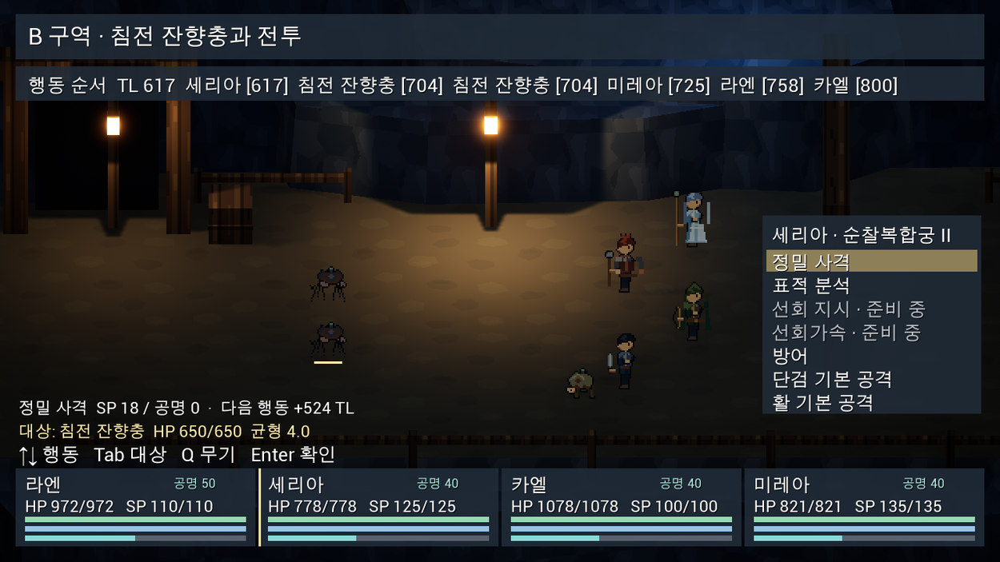

# 계약과 공명 RPG

강제 계약 실험을 겪은 주인공이 어린 결정등 거북과 서로의 동의로 첫 계약을 맺습니다. 저는 인간과 계약체가 서로의 힘을 빌리는 관계를 이야기, 턴제 전투와 마지막 선택에 반영하도록 게임 방향과 규칙을 정했습니다.

[기획서 v0.11 전문](design/RPG_GDD_v0.11.pdf) · [초기 기획서 v0.4](design/RPG_게임_기획서_v0.4.docx) · [데모 명세와 규칙 검사](rules-v0.11/README.md)

## 전투와 탐색에서 하는 선택

아군과 적은 각자의 시간표에 따라 행동합니다. 보스가 두 차례 뒤에 큰 공격을 준비할 때 회복 담당의 차례를 당기거나, 적 행동을 늦추거나, 계약체의 보호막으로 버티는 선택을 기획했습니다. 지역의 문제를 해결하며 누구와 협력했는지에 따라 마지막에 공명의 힘을 나누어 관리하는 길이 열립니다.

## 개발본에서 확인한 범위

초기 구상 이후 UE 5.8.1, C++20, Lua로 만든 광산 데모에서 두 구역 탐색, 잔향충 두 마리와 전투, 한 번의 보상 지급과 필드 복귀를 확인했습니다. 아래 예시는 실제 전투입니다. 정밀 사격을 선택하면 SP 18과 다음 행동까지 걸리는 시간이 표시됩니다. 캠페인의 보스전과 결말 분기는 기획서에 담긴 범위입니다.

[광산 탐색 화면](screens/rpg_exploration.jpg) · [실행 검증 항목과 결과](screens/runtime-verification.json)

기획서의 자료 정리와 초안 구성에는 AI를 활용했습니다. 게임의 방향과 규칙 선택, 최종 문서 편집을 맡았습니다. 검사 결과 파일에는 원본 실행 기록에서 시각, 검사명과 판정만 옮겼습니다.
