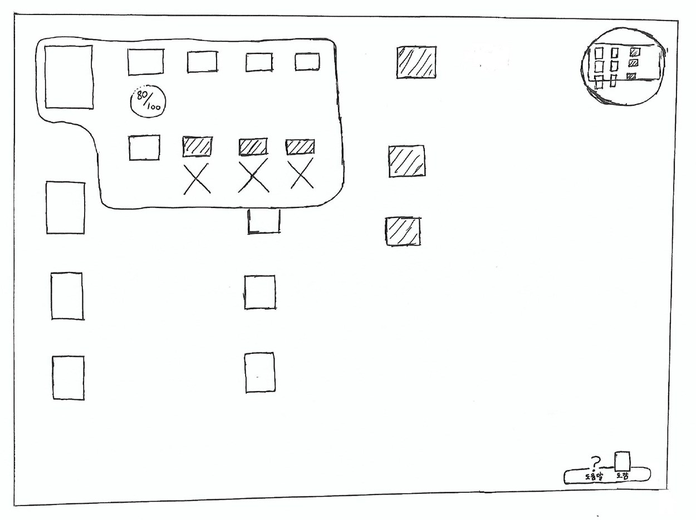

# By the Cthul

윌버 웨이틀리는 낮에는 평범한 시민으로 일하고, 밤에는 동료를 보내 크툴루의 부활 방법을 찾습니다. 한 사람만 몰래 보내면 탐색이 실패하기 쉽고, 여러 명을 동원하면 들킬 위험이 커집니다. 윌버의 연구가 발각됐는지에 따라 마지막 장면이 달라지는 싱글플레이 카드 전략 게임입니다.

| 작업 | 작성 시점 | 읽을 자료 |
| --- | --- | --- |
| 게임기획 수업 개인 과제 | 2021년 4~5월 | [중간·기말 제안서 원문 발췌 PDF](originals/2021-proposal-excerpts.pdf) |
| 직접 그린 카드 보드 | 2021년 5월 | [인물별 슬롯과 닫힌 행동 칸 시안](originals/card-board.jpg) |
| 포트폴리오용 기획 보완 | 2026년 11월 | [한 판을 진행하는 규칙](design/paper-rules.md) · [플레이 예시와 검증 기준](design/first-playthrough.md) |

## 2021년에 기획한 내용

크툴루 신화에 익숙하지 않은 사람도 인물과 유물을 한 가지씩 조사하며 이야기를 따라오도록 구상했습니다. 4월에는 사건이 생기면 인물 옆에 카드 슬롯이 열리고, 어떤 카드를 넣느냐에 따라 다음 행동이 달라지는 보드를 제안했습니다. 5월에는 윌버에게 부활 연구라는 목적을 주고 낮의 일·공부·포섭과 밤의 탐색·연구·치료를 나눴습니다. 동굴, 거미줄, 서고를 공략한 뒤 마도서를 해독하면 최종 목적지 르뤼에에 갈 수 있습니다.

야간 탐색에는 정보 1장과 인물 1~4명, 자금 2~4개를 넣습니다. 많이 투입할수록 성공 확률이 올라가고 탐색 결과에 관계없이 스트레스 30이 쌓입니다. 별도 전투 조작은 기말안에서 제외했습니다. 누구를 보낼지, 다음 연구에 쓸 자금을 얼마나 남길지 고민하는 게임을 만드는 데 집중하기 위해서였습니다.

기말안 37~38쪽에 사용한 손그림입니다. 인물 카드를 어느 위치에 놓을지 검토할 때 그렸고, X 표시로 아직 쓸 수 없는 행동 칸을 구별했습니다.

## 이번에 보완한 내용

원안으로는 인물 한 명을 더 보냈을 때 성공 확률이 얼마나 달라지는지, 탐색에서 받은 스트레스 30과 치료로 없애는 카드 한 장이 어떤 관계인지 알기 어려웠습니다. 연구 발각도 결말에는 등장하지만 플레이 중 무엇이 발각으로 이어지는지 기준이 없었습니다. 보완안에서는 인원·자금별 확률, 스트레스가 카드로 바뀌는 시점, 탐색 규모와 소문이 발각에 미치는 영향을 정했습니다. 종이와 주사위로 처음부터 결말까지 한 판을 진행할 수 있습니다.

2021년 원안과 손그림은 이태현의 수업 작업입니다. 2026년 종이 규칙과 예시 진행은 그 자료를 바탕으로 AI와 함께 정리한 후속 제안입니다. 예시의 주사위 값은 규칙을 확인하려고 지정한 값이며 플레이테스트 통계는 아직 없습니다. 중간안에 적은 참고 게임은 *Cultist Simulator*입니다. 공개 자료에는 직접 작성한 문장과 직접 그린 보드만 실었습니다.
